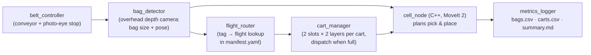

# Robotic Baggage Make-up Cell (ROS 2 + MoveIt 2)

[](https://docs.ros.org/en/jazzy/)
[](https://moveit.ai/)
[](https://gazebosim.org/)
[](https://www.universal-robots.com/)
[](LICENSE)

A simulated robot cell that sorts checked bags from a conveyor into per-flight
carts — the "make-up" step done by hand today at regional airports such as
Monastir (Tunisia). **Proof of concept in simulation**, not a cost/ROI claim.

A UR10e with a suction cup picks each bag off the belt, the tag is looked up
to find its flight, and the bag is placed in the right cart (or the reject
area). Every run writes CSV logs and a Markdown summary.

## Example result (5 bags, seed 1)

| Metric | Value |
|---|---|
| Pick-and-place success | 5/5 (100 %) |
| Correct cart | 5/5 (100 %) |
| Mean cycle time (sim) | 14.2 s |
| Throughput, 1 robot | 254 bags/h |
| Mean MoveIt planning time | 0.17 s |
| Perception centre error | 2.6 mm |

Full output: [`results/run_20261118_224155/`](results/run_20261118_224155/)

## How it works



| Package | Contents |
|---|---|
| `bag_cell_description` | UR10e + suction tool URDF, restricted joint limits |
| `bag_cell_bringup` | Gazebo world, launch files, MoveIt config |
| `bag_cell_scene` | Conveyor, flight router, MoveIt collision scene, bag manifest |
| `bag_cell_perception` | Depth-camera bag detector (geometry only) |
| `bag_cell_planning` | Cart manager, metrics logger |
| `bag_cell_motion` | C++ cell node driving MoveIt 2 |
| `bag_cell_interfaces` | Custom messages and services |

## Requirements

- Ubuntu 24.04, ROS 2 Jazzy, Gazebo Harmonic
- MoveIt 2, `ur_description`, `ur_moveit_config`, `ur_simulation_gz`, TRAC-IK

## Build

```bash
cd ws
rosdep install --from-paths src --ignore-src -y
colcon build --symlink-install
source install/setup.bash
```

## Run

Terminal 1 — simulation + MoveIt + RViz:

```bash
ros2 launch bag_cell_bringup bag_cell.launch.py results_dir:=$HOME/bag_cell_results seed:=1
```

Terminal 2 — start feeding bags:

```bash
ros2 launch bag_cell_bringup cell.launch.py num_bags:=10
```

Results appear in `results_dir/run_<timestamp>/`.

## Limitations

- Simulation only; bag physics are simplified (rigid boxes).
- Tag reading is simulated with a random no-read rate; no real barcode/RFID.
- The flight lookup uses a static manifest instead of a live airline system.

## License

MIT — see [LICENSE](LICENSE).
