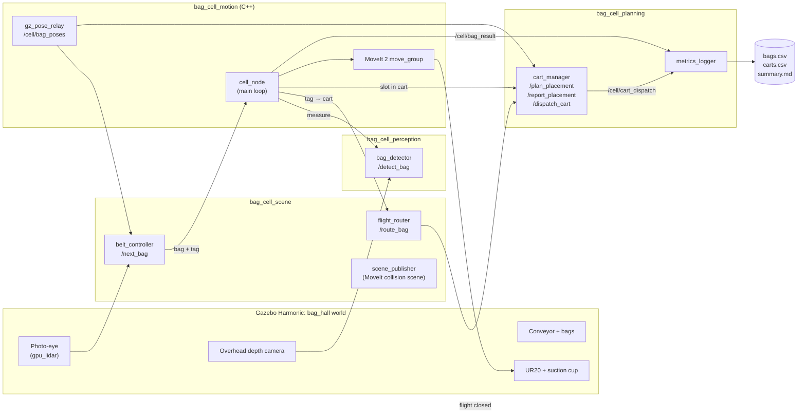
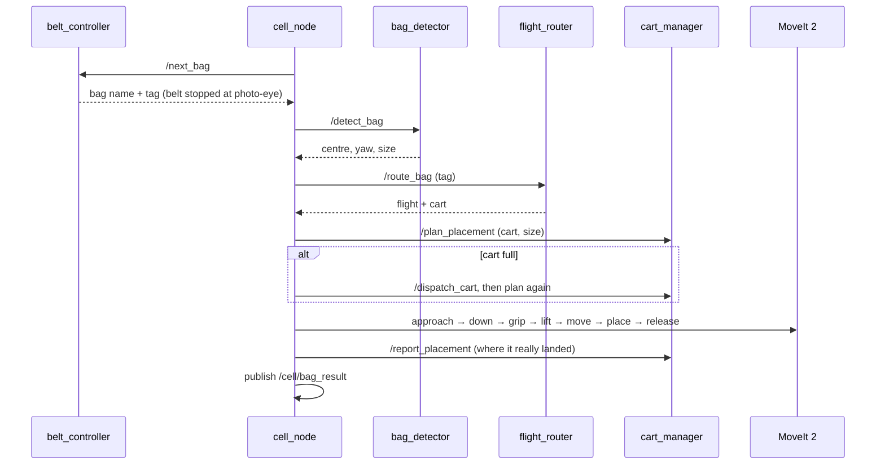

# 🧳 Robotic Baggage Make-up Cell (ROS 2 + MoveIt 2)

[](https://docs.ros.org/en/jazzy/)
[](https://moveit.ai/)
[](https://gazebosim.org/)
[](https://www.universal-robots.com/)
[]()
[](LICENSE)

A simulated robot cell that sorts checked bags from a conveyor into per-flight carts,
the **baggage make-up** step that is still done by hand at regional airports such as
Monastir (Tunisia).

A **UR20 with a suction cup** waits at the end of a make-up belt. Each bag stops at a
photo-eye, an **overhead depth camera** measures it, its tag is looked up in the check-in
manifest to find its flight, a **height-map packer** picks a spot in that flight's cart,
and **MoveIt 2** plans the pick and the place. Every run writes CSV logs and a Markdown summary.

> **Scope:** a proof of concept in simulation, to measure feasibility (success rate, cycle
> time, throughput). It makes no claims about cost or ROI.

<!-- Demo GIF / screenshots go here (docs/media/) -->

---

## 📊 Example Result (10 bags, seed 1)

| Metric | Value |
| :--- | :--- |
| Pick-and-place success | **10/10 (100 %)** |
| Correct cart (of successful picks) | **10/10 (100 %)** |
| Mean cycle time (sim) | 8.8 s |
| Throughput, 1 robot | **410 bags/h** |
| Mean MoveIt planning time per bag | 0.28 s |
| Perception: centre error | 2.4 mm |
| Perception: long / short side error | 3.2 mm / 3.4 mm |
| Perception: yaw error | 0.04° |

Full output: [`results/run_20261121_010234/`](results/run_20261121_010234/)
(`bags.csv`, `carts.csv`, `summary.md`)

---

## 🌟 Key Features

- **Realistic make-up belt**: bags come out of a wall hatch with random gaps and
  orientations. The belt stops when a bag cuts the **photo-eye** (a GPU-lidar beam) and
  restarts once the robot has lifted the bag away.
- **Depth-camera perception** (geometry only, no ML): an overhead depth image is projected
  to 3D, the bag that stopped the belt is isolated, and `cv2.minAreaRect` on its top face
  gives the centre, yaw, length, width and height.
- **Flight routing with a schedule**: a check-in manifest and a compressed airport clock.
  Each flight's make-up opens and closes on one of two cart positions; an early-bag store
  holds a bag until its flight opens.
- **Height-map cart packing** (palletizing-style): the cart floor is a 5 cm grid. Each bag
  goes where it rests lowest, filling the cart from the back. Spots with less than
  60 % support, or that the arm can't reach, are rejected. The map is updated with where the
  bag **really** landed in Gazebo.
- **MoveIt 2 motion**: OMPL for free moves around the cell, straight Cartesian moves near
  the bag and the cart. Bags are symmetric, so the planner can choose between yaw and
  yaw + 180°.
- **Tuned for reliability**: the UR20 joint limits are restricted to a single arm posture
  (elbow up, tool down), and **TRAC-IK** (Speed mode) replaces KDL.
- **Suction grip in Gazebo**: `DetachableJoint` is added to the bag at runtime through
  gz-transport, without calling the slow `gz` command line.
- **Cart dispatch**: when a cart is full or its flight closes, a tug "tows" it away and an
  empty cart replaces it.
- **Metrics out of the box**: one CSV row per bag (cycle time, planning time, perception
  error vs ground truth, target vs actual cart) and one per dispatched cart (fill ratio,
  stack height).

---

## 🏗️ System Architecture



---

## 🔄 Cycle of One Bag



The next bag is requested as soon as the current one leaves the belt, so the belt brings
it in while the arm is still placing.

---

## 📦 Packages

| Package | Language | Contents |
| :--- | :--- | :--- |
| `bag_cell_description` | xacro / YAML | UR20 + suction tool URDF, cell-specific joint limits |
| `bag_cell_bringup` | Python launch / SDF | Gazebo world (+ generator script), launch files, MoveIt config, TRAC-IK |
| `bag_cell_scene` | Python | Belt controller, flight router, MoveIt collision scene, check-in manifest |
| `bag_cell_perception` | Python + OpenCV | Overhead depth-camera bag detector |
| `bag_cell_planning` | Python | Height-map cart manager, metrics logger |
| `bag_cell_motion` | C++ | `cell_node` (MoveIt main loop), `gz_pose_relay` (Gazebo poses → ROS) |
| `bag_cell_interfaces` | msg / srv | Custom messages and services (below) |

### Custom interfaces

| Interface | Type | Purpose |
| :--- | :--- | :--- |
| `NextBag` | srv | Wait for the next bag at the photo-eye: name, tag read, ground truth |
| `DetectBag` | srv | Measure the bag in the pick zone: pose + size |
| `RouteBag` | srv | Tag → flight → cart (`cart_a` or `cart_b`) |
| `PlanPlacement` | srv | Release pose for a bag in a cart, or "full" |
| `ReportPlacement` | srv | Where the bag really landed (from Gazebo) |
| `DispatchCart` | srv | Tow a cart away (full / flight closed) and bring an empty one |
| `BagResult` | msg | One log line per bag: carts, success, cycle/planning time, perception error |
| `CartDispatch` | msg | One log line per dispatched cart: flight, bags, fill ratio, stack height |

---

## 📁 Repository Structure

```
.
├── ws/src/
│   ├── bag_cell_bringup/      # launch/, config/, worlds/ (bag_hall.sdf + generate_world.py)
│   ├── bag_cell_description/  # urdf/bag_cell_robot.urdf.xacro, config/joint_limits.yaml
│   ├── bag_cell_interfaces/   # msg/, srv/
│   ├── bag_cell_motion/       # src/cell_node.cpp, src/gz_pose_relay.cpp
│   ├── bag_cell_perception/   # bag_detector.py
│   ├── bag_cell_planning/     # cart_manager.py, metrics_logger.py
│   └── bag_cell_scene/        # belt_controller.py, flight_router.py, scene_publisher.py,
│                              # config/manifest.yaml
├── results/                   # example run output
├── LICENSE
└── README.md
```

---

## ⚡ Quickstart

### 1. Prerequisites

- Ubuntu 24.04, **ROS 2 Jazzy**, **Gazebo Harmonic**
- MoveIt 2, `ur_description`, `ur_moveit_config`, `ur_simulation_gz`, TRAC-IK

```bash
sudo apt install ros-jazzy-moveit ros-jazzy-ur-description ros-jazzy-ur-moveit-config \
  ros-jazzy-ur-simulation-gz ros-jazzy-trac-ik-kinematics-plugin ros-jazzy-ros-gz
```

### 2. Clone and build

```bash
git clone https://github.com/chaabanejasser01/ros2-baggage-makeup-cell.git
cd ros2-baggage-makeup-cell/ws
rosdep install --from-paths src --ignore-src -y
colcon build --symlink-install
source install/setup.bash
```

### 3. Run

**Terminal 1**: Gazebo + MoveIt + RViz

```bash
ros2 launch bag_cell_bringup bag_cell.launch.py results_dir:=$HOME/bag_cell_results seed:=1
```

Wait for `You can start planning now!` from `move_group`.

**Terminal 2**: start the cell

```bash
ros2 launch bag_cell_bringup cell.launch.py num_bags:=10
```

Results appear in `results_dir/run_<timestamp>/`.

### 4. Record a demo video

Gazebo without RViz looks best on video. Start the sim with `rviz:=false`, then record the
screen with `ffmpeg` while the cell runs:

```bash
ffmpeg -video_size 1920x1080 -framerate 30 -f x11grab -i :0.0 -c:v libx264 -preset ultrafast -crf 23 demo.mp4
```

Stop with `q`. To make a short GIF for this page:

```bash
ffmpeg -ss 0 -t 20 -i demo.mp4 -vf "fps=12,scale=960:-1:flags=lanczos" demo.gif
```

### 5. Tests

```bash
colcon test --packages-select bag_cell_scene && colcon test-result --verbose
```

---

## ⚙️ Configuration

| Parameter | Where | Default | Meaning |
| :--- | :--- | :--- | :--- |
| `seed` | `bag_cell.launch.py` | `1` | Random seed (bag positions on the belt) |
| `results_dir` | `bag_cell.launch.py` | `~/bag_cell_results` | Output folder for CSV + summary |
| `rviz` | `bag_cell.launch.py` | `true` | Start RViz |
| `num_bags` | `cell.launch.py` | `10` | Bags to handle in this run |
| `velocity_scaling` | `config/cell_node.yaml` | `0.6` | MoveIt velocity scaling |
| `speed` | `belt_controller` | `0.7` m/s | Belt speed |
| `no_read_rate` | `belt_controller` | `0.05` | Share of bags whose tag is not read |
| flights / bags | `bag_cell_scene/config/manifest.yaml` | 6 flights, 32 bags | Schedule and check-in list |

To change the hall, edit `bag_cell_bringup/worlds/generate_world.py` and run it again. It
regenerates `bag_hall.sdf` and the sign textures.

---

## ⚠️ Limitations

- Simulation only. Bags are rigid boxes with simplified physics.
- Every tag is read: no no-reads, mis-sorted or late bags (in a real hall these go to
  manual handling). No real barcode or RFID.
- Flight lookup uses a static manifest, not a live airline / BHS system.
- A single robot and two make-up positions. Arm reach limits each 1.6 × 1.2 m cart to about 14–20 bags.

---

## 👤 Author

**Jasser Chaabane**, mechatronics engineering student (robotics, ROS 2, embedded)
[Portfolio](https://chaabanejasser01.github.io) · [GitHub](https://github.com/chaabanejasser01)

## 📄 License

MIT. See [LICENSE](LICENSE).
